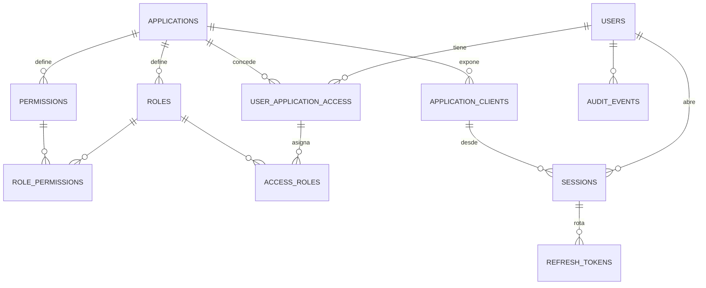
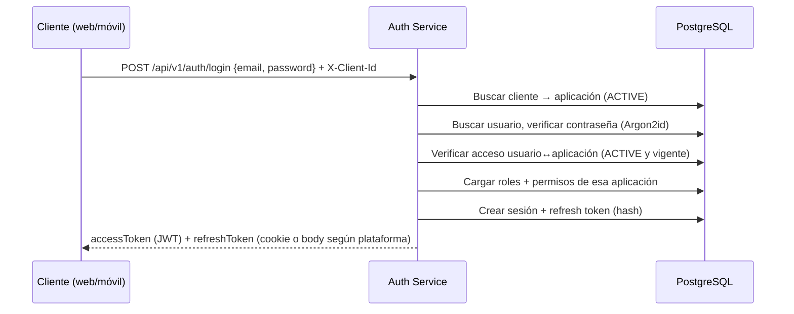

# Arquitectura — Authentication App

> Estado: **Propuesta aprobada para v1** · Última actualización: 2026-11-27

## 1. Objetivo

Servicio centralizado de **identidad y control de acceso** que:

1. Gestiona el ciclo de vida de los usuarios (registro, login, sesiones, contraseñas).
2. Controla el acceso de esos usuarios a **N aplicaciones** registradas en la plataforma.
3. Define, por cada aplicación, sus **roles y permisos**, y emite tokens con la autorización correspondiente.
4. Permite que cualquier aplicación cliente (frontend web, app móvil o backend) valide los tokens de forma autónoma mediante la clave pública (JWKS), sin consultar al servicio en cada petición.

## 2. Decisiones confirmadas

| Tema | Decisión |
|---|---|
| Lenguaje | **Java 25 (LTS)** |
| Framework | **Spring Boot 4.0.x** (Spring Security 7) |
| Build | **Maven** (con wrapper `mvnw`) |
| Consumidores | **Frontend web y aplicaciones móviles** (ambos) |
| Verificación de email | **Fuera de v1** — se implementará en una versión futura |
| Rama de trabajo | `developer` |

## 3. Stack tecnológico

| Capa | Tecnología | Motivo |
|---|---|---|
| Base de datos | PostgreSQL 17 | Robusta, `uuid`, `citext`, `jsonb` |
| Persistencia | Spring Data JPA (Hibernate) | Productividad en un dominio relacional |
| Migraciones | Flyway | Esquema versionado y reproducible |
| Tokens | Spring Security OAuth2 Resource Server (Nimbus JOSE) — **JWT RS256** | Firma asimétrica: las aplicaciones validan con la clave pública |
| Hash de contraseñas | Argon2id vía `DelegatingPasswordEncoder` | Recomendación OWASP; permite migrar de algoritmo |
| Validación | Jakarta Bean Validation | Integrado en Spring MVC |
| Mapeo | Mappers explícitos en cada adaptador | El dominio es inmutable y se construye con fábricas (`create`/`restore`); el mapeo manual es más claro que MapStruct en este caso |
| Rate limiting | Bucket4j | Protección contra fuerza bruta |
| Documentación de la API | springdoc-openapi (Swagger UI) | API autodocumentada |
| Observabilidad | Actuator + Micrometer, logs JSON | Health checks, métricas, auditoría |
| Tests | JUnit 5, Mockito, Testcontainers, MockMvc, ArchUnit | Integración contra una base de datos real y reglas de arquitectura |
| Calidad | Spotless (Google Java Format), JaCoCo ≥ 80 % | Formato consistente y cobertura medida |
| Entorno local | Docker Compose (PostgreSQL) | Levantar el entorno con un solo comando |
| CI | GitHub Actions | Build, tests y cobertura en cada PR |

> **Spring Authorization Server**: no se usa en v1. El contrato de tokens (`iss`, `aud`, `azp`, JWKS) se diseña compatible con OAuth2/OIDC para poder migrar en el futuro (SSO, `authorization_code` + PKCE) sin romper a los clientes.

## 4. Estilo arquitectónico

**Arquitectura hexagonal (puertos y adaptadores)**, organizada por módulos funcionales (*bounded contexts*) dentro de un único artefacto Maven (monolito modular).

```
com.henryfll.auth
├── AuthApplication.java
├── user/                     # Identidad de usuarios
├── apps/                     # Aplicaciones, clientes, roles y permisos
├── access/                   # Concesión de acceso usuario ↔ aplicación y roles asignados
├── auth/                     # Login, tokens, sesiones, refresh, logout
├── audit/                    # Registro y consulta de eventos de seguridad
└── shared/                   # Errores (RFC 9457), configuración, API de auditoría, utilidades
```

Cada módulo sigue la misma estructura interna:

```
<modulo>/
├── domain/                   # Entidades, value objects, reglas de negocio (Java puro)
├── application/
│   ├── port/in/              # Casos de uso (interfaces)
│   ├── port/out/             # Repositorios, servicios externos (interfaces)
│   └── service/              # Implementación de los casos de uso
└── infrastructure/
    ├── web/                  # Controllers REST + DTOs (records)
    └── persistence/          # Entidades JPA + adaptadores de repositorio
```

**Reglas, verificadas con ArchUnit**

- `domain` no depende de Spring ni de JPA.
- `application` no depende de `infrastructure`.
- Los controllers solo invocan puertos de entrada (`port.in`).
- Un módulo solo accede a otro a través de sus puertos de entrada, nunca a su persistencia.

### 4.1 Responsabilidades de cada módulo

| Módulo | Responsabilidad |
|---|---|
| **user** | Alta de usuarios, perfil, cambio de contraseña, estado de la cuenta (activo, bloqueado, deshabilitado) |
| **apps** | Registro de aplicaciones, sus clientes (web, móvil, servicio), el catálogo de permisos y los roles de cada aplicación |
| **access** | Qué usuarios pueden entrar a qué aplicaciones, con qué roles y hasta cuándo |
| **auth** | Autenticación, emisión de JWT con los roles y permisos de la aplicación, sesiones, rotación de refresh tokens y JWKS |

## 5. Modelo de dominio: control de acceso multi-aplicación

### 5.1 Conceptos

- **Application**: producto o sistema protegido (p. ej. `erp`, `crm`, `portal-clientes`). Es la unidad de autorización: los roles y permisos pertenecen a una aplicación.
- **ApplicationClient**: forma concreta de consumir una aplicación. Una aplicación puede tener varios clientes: `WEB`, `MOBILE`, `SERVICE`. Cada cliente tiene su propio `client_id` y su configuración (orígenes permitidos, duración de tokens, secreto si es confidencial).
- **Permission**: acción atómica dentro de una aplicación (p. ej. `invoice:read`, `invoice:approve`).
- **Role**: agrupación de permisos **dentro de una aplicación** (p. ej. `erp:ACCOUNTANT`).
- **UserApplicationAccess**: concesión de acceso de un usuario a una aplicación, con estado y vigencia opcional.
- **Asignación de roles**: roles de esa aplicación asignados al usuario dentro de su acceso.

**La propia plataforma es una aplicación.** El servicio se registra a sí mismo como la aplicación `auth-admin`, con roles como `SUPER_ADMIN` o `APP_MANAGER`. Así la administración de la plataforma usa el mismo modelo de autorización y no hacen falta "roles globales" especiales.

### 5.2 Diagrama entidad-relación



### 5.3 Tablas

**Identidad**

```sql
users
  id                     UUID PK
  email                  CITEXT UNIQUE NOT NULL
  password_hash          VARCHAR NOT NULL
  first_name, last_name  VARCHAR
  status                 VARCHAR NOT NULL   -- ACTIVE | LOCKED | DISABLED
  email_verified_at      TIMESTAMPTZ NULL   -- reservado para la verificación de email (futuro)
  failed_login_attempts  INT NOT NULL DEFAULT 0
  locked_until           TIMESTAMPTZ NULL
  password_changed_at    TIMESTAMPTZ
  created_at, updated_at TIMESTAMPTZ
  version                BIGINT             -- bloqueo optimista
```

**Aplicaciones**

```sql
applications
  id                       UUID PK
  code                     VARCHAR UNIQUE NOT NULL  -- slug estable, p. ej. "erp"; se usa como `aud` del JWT
  name                     VARCHAR NOT NULL
  description              TEXT
  status                   VARCHAR NOT NULL          -- ACTIVE | INACTIVE
  self_registration        BOOLEAN NOT NULL DEFAULT FALSE  -- ¿se puede auto-registrar un usuario en esta app?
  default_role_id          UUID NULL FK roles        -- rol asignado al auto-registrarse
  created_at, updated_at, version

application_clients
  id                       UUID PK
  application_id           UUID FK applications
  client_id                VARCHAR UNIQUE NOT NULL   -- identificador público que envía el frontend
  name                     VARCHAR NOT NULL          -- p. ej. "ERP Web", "ERP Android"
  platform                 VARCHAR NOT NULL          -- WEB | MOBILE | SERVICE
  confidential             BOOLEAN NOT NULL          -- true solo para SERVICE
  client_secret_hash       VARCHAR NULL
  allowed_origins          TEXT[]                    -- CORS para clientes WEB
  access_token_ttl_seconds  INT NOT NULL              -- por defecto 900 (15 min); entre 1 min y 1 h
  refresh_token_ttl_seconds INT NOT NULL              -- por defecto 7 días (web) o 30 días (móvil); entre 1 h y 90 días
  status                   VARCHAR NOT NULL          -- ACTIVE | INACTIVE
  created_at, updated_at, version

permissions
  id                       UUID PK
  application_id           UUID FK applications
  code                     VARCHAR NOT NULL          -- "invoice:approve"
  description              TEXT
  UNIQUE (application_id, code)

roles
  id                       UUID PK
  application_id           UUID FK applications
  code                     VARCHAR NOT NULL          -- "ACCOUNTANT"
  name                     VARCHAR NOT NULL
  description              TEXT
  UNIQUE (application_id, code)

role_permissions
  role_id                  UUID FK roles
  permission_id            UUID FK permissions
  PRIMARY KEY (role_id, permission_id)
  -- regla: el rol y el permiso deben pertenecer a la misma aplicación
```

**Acceso**

```sql
user_application_access
  id                       UUID PK
  user_id                  UUID FK users
  application_id           UUID FK applications
  status                   VARCHAR NOT NULL          -- ACTIVE | SUSPENDED | REVOKED
  valid_from               TIMESTAMPTZ NOT NULL
  valid_until              TIMESTAMPTZ NULL          -- acceso temporal opcional
  granted_by               UUID NULL FK users
  created_at, updated_at, version
  UNIQUE (user_id, application_id)

access_roles
  access_id                UUID FK user_application_access
  role_id                  UUID FK roles
  PRIMARY KEY (access_id, role_id)
  -- regla: el rol debe pertenecer a la misma aplicación del acceso
```

**Sesiones y tokens**

```sql
sessions                                    -- una por login (dispositivo/navegador + cliente)
  id                       UUID PK
  user_id                  UUID FK users
  client_id                UUID FK application_clients
  ip_address               INET
  user_agent               VARCHAR
  device_name              VARCHAR NULL      -- informado por la app móvil
  created_at               TIMESTAMPTZ
  last_used_at             TIMESTAMPTZ
  revoked_at               TIMESTAMPTZ NULL
  revoked_reason           VARCHAR NULL      -- LOGOUT | LOGOUT_ALL | REUSE_DETECTED | ADMIN | ACCESS_REVOKED

refresh_tokens
  id                       UUID PK
  session_id               UUID FK sessions  -- la sesión es la "familia" de rotación
  token_hash               CHAR(64) UNIQUE   -- SHA-256; nunca se guarda el valor original
  expires_at               TIMESTAMPTZ
  used_at                  TIMESTAMPTZ NULL
  replaced_by              UUID NULL FK refresh_tokens
  created_at               TIMESTAMPTZ
```

**Auditoría**

```sql
audit_events
  id                       UUID PK
  type                     VARCHAR NOT NULL  -- LOGIN_SUCCESS, LOGIN_FAILED, ACCESS_DENIED, ACCESS_GRANTED,
                                             -- ROLE_ASSIGNED, PASSWORD_CHANGED, REFRESH_REUSE_DETECTED, ...
  actor_user_id            UUID NULL
  target_user_id           UUID NULL
  application_id           UUID NULL
  client_id                UUID NULL
  ip_address               INET
  metadata                 JSONB
  created_at               TIMESTAMPTZ
```

### 5.4 Reglas de negocio clave

1. Un usuario solo puede autenticarse en una aplicación si existe un acceso con estado `ACTIVE` dentro de su vigencia (`valid_from ≤ now < valid_until`), la aplicación y el cliente están `ACTIVE` y el usuario está `ACTIVE`.
2. Suspender o revocar un acceso **revoca las sesiones abiertas** de ese usuario en esa aplicación. Los access tokens ya emitidos siguen siendo válidos hasta que caducan (máximo 15 min); no se renuevan.
3. Los roles y permisos son siempre locales a una aplicación: un rol de `erp` nunca puede asignarse a un acceso de `crm`.
4. El auto-registro solo se permite en aplicaciones con `self_registration = true`, y asigna `default_role_id`. En el resto, el acceso lo concede un administrador.
5. Los usuarios son globales: una misma cuenta (email y contraseña) puede tener acceso a varias aplicaciones.

## 6. Estrategia de tokens

### 6.1 Access token (JWT RS256)

Se emite **por aplicación**: solo contiene la autorización de la aplicación del cliente que hizo el login.

```json
{
  "iss": "https://auth.example.com",
  "sub": "8f3c…-uuid-usuario",
  "aud": "erp",
  "azp": "erp-web",
  "sid": "uuid-sesion",
  "jti": "uuid-token",
  "iat": 1764259200,
  "exp": 1764260100,
  "email": "user@example.com",
  "roles": ["ACCOUNTANT"],
  "permissions": ["invoice:read", "invoice:approve"]
}
```

- `aud` es el `code` de la aplicación: cada backend valida que el token esté emitido para él.
- `azp` es el `client_id` que lo solicitó, y `sid` permite relacionar el token con la sesión.
- Duración por defecto: 15 minutos, configurable por cliente.
- Las claves RSA llevan `kid` para poder rotarlas y se publican en `/.well-known/jwks.json`.

### 6.2 Refresh token

- Valor opaco aleatorio de 256 bits, del que solo se persiste el hash SHA-256.
- **Rotación en cada uso con detección de reutilización**: si se presenta un token ya usado, se revoca la sesión completa (`REUSE_DETECTED`).
- Cada refresh vuelve a comprobar las reglas de acceso de la sección 5.4: si se ha revocado el acceso o cambiado los roles, el siguiente access token lo refleja.

**Implementación (fase 4)**

- El access token lleva el claim `sid`, la sesión a la que pertenece. `/users/me/sessions` lo usa para marcar la sesión actual y `logout` para saber qué sesión cerrar.
- **Marcado atómico:** un token se marca como usado con un `UPDATE … WHERE used_at IS NULL`. De dos refresh simultáneos con el mismo token, solo uno lo consigue; el otro se trata como reutilización y revoca la sesión.
  - Consecuencia: si un frontend web lanza dos refresh a la vez (por ejemplo, desde dos pestañas), el usuario tendrá que volver a iniciar sesión. El frontend debe serializar los refresh. Un periodo de gracia para este caso queda como mejora futura.
- **Comprobaciones en cada refresh**, en este orden:
  1. El cliente (`X-Client-Id`) es el mismo que abrió la sesión y está activo.
  2. El transporte es el que corresponde: cookie en web, body en móvil.
  3. El `Origin` es uno de los permitidos (solo web).
  4. La sesión está activa y el token no se ha usado ni ha caducado.
  5. La cuenta está activa.
  6. El acceso a la aplicación sigue siendo efectivo.
- **Si falla la cuenta o el acceso**, se revoca la sesión (`USER_INACTIVE` / `ACCESS_REVOKED`) y la revocación se confirma aunque la petición devuelva error.
- **Vigencia del refresh token:** cada refresh token caduca a los `refresh_token_ttl_seconds` del cliente desde su emisión, así que la sesión se mantiene mientras el usuario la siga usando. Un límite absoluto de duración de la sesión y una tarea de limpieza de sesiones caducadas quedan como mejoras futuras.

**Revocación de sesiones desde otros módulos (§5.4, regla 2)**

Los módulos `access` y `user` publican eventos de Spring (`AccessWithdrawnEvent`, `UserDeactivatedEvent`) y `auth` los escucha en la misma transacción:

| Evento | Cuándo | Sesiones revocadas |
|---|---|---|
| `AccessWithdrawnEvent` | Un acceso pasa a `SUSPENDED` o `REVOKED` | Las del usuario en esa aplicación (`ACCESS_REVOKED`) |
| `UserDeactivatedEvent` | Una cuenta pasa a `LOCKED` o `DISABLED` | Todas las del usuario (`USER_INACTIVE`) |

Un acceso que caduca por su vigencia no genera evento: lo detecta el siguiente refresh. Los access tokens ya emitidos siguen siendo válidos hasta que caducan (15 min por defecto).

### 6.3 Web y móvil

| Aspecto | Cliente `WEB` | Cliente `MOBILE` |
|---|---|---|
| Identificación | Header `X-Client-Id` | Header `X-Client-Id` |
| Access token | En el body de la respuesta, guardado en memoria | En el body de la respuesta |
| Refresh token | Cookie `HttpOnly; Secure; SameSite=Strict; Path=/api/v1/auth` (**no** se devuelve en el body) | En el body, guardado en Keychain o Keystore |
| Envío del refresh token | Automático por la cookie | Body `{ "refreshToken": "…" }` |
| CSRF | Cookie `SameSite=Strict` + validación de `Origin` contra `allowed_origins` | No aplica |
| Duración del refresh token | 7 días (por defecto) | Configurable, p. ej. 30 días |

El comportamiento lo decide la **plataforma del cliente registrado**, no un parámetro que envíe el llamante, así que no se puede forzar el modo móvil desde un navegador.

### 6.4 Flujo de login



## 7. API REST (v1)

Todos los endpoints llevan el prefijo `/api/v1`. Los errores siguen **RFC 9457 (Problem Details)** con códigos propios (`AUTH_INVALID_CREDENTIALS`, `ACCESS_NOT_GRANTED`, `CLIENT_INACTIVE`, …).

### 7.1 Autenticación — módulo `auth`

| Método | Endpoint | Descripción | Auth |
|---|---|---|---|
| POST | `/auth/register` | Auto-registro en una aplicación con `self_registration` | Pública + `X-Client-Id` |
| POST | `/auth/login` | Login en la aplicación del cliente | Pública + `X-Client-Id` (con rate limit) |
| POST | `/auth/refresh` | Rota el refresh token | Refresh token |
| POST | `/auth/logout` | Revoca la sesión actual | Bearer |
| POST | `/auth/logout-all` | Revoca todas las sesiones del usuario | Bearer |
| GET | `/.well-known/jwks.json` (sin prefijo) | Claves públicas | Pública |

### 7.2 Usuario autenticado — módulos `user` y `access`

| Método | Endpoint | Descripción |
|---|---|---|
| GET | `/users/me` | Perfil |
| PUT | `/users/me/password` | Cambio de contraseña (pide la actual; revoca las demás sesiones) |
| GET | `/users/me/applications` | Aplicaciones a las que tiene acceso, para un lanzador de apps |
| GET | `/users/me/sessions` | Sesiones o dispositivos activos |
| DELETE | `/users/me/sessions/{id}` | Cerrar una sesión concreta |

### 7.3 Administración — requiere roles de la aplicación `auth-admin`

| Método | Endpoint | Descripción |
|---|---|---|
| GET / POST | `/admin/applications` | Listar o crear aplicaciones |
| GET / PATCH | `/admin/applications/{appId}` | Detalle o actualización (incluye activar/desactivar) |
| GET / POST | `/admin/applications/{appId}/clients` | Clientes de la aplicación |
| PATCH | `/admin/applications/{appId}/clients/{clientId}` | Actualizar cliente (orígenes, TTL, estado) |
| POST | `/admin/applications/{appId}/clients/{clientId}/secret` | Regenerar el secreto (clientes `SERVICE`) |
| GET / POST | `/admin/applications/{appId}/permissions` | Catálogo de permisos |
| GET / POST | `/admin/applications/{appId}/roles` | Roles de la aplicación |
| PUT | `/admin/applications/{appId}/roles/{roleId}/permissions` | Definir los permisos de un rol |
| GET / POST | `/admin/users` | Listar (paginado) o crear usuarios |
| PATCH | `/admin/users/{userId}/status` | Bloquear, activar o deshabilitar |
| GET | `/admin/users/{userId}/access` | Accesos del usuario |
| PUT | `/admin/applications/{appId}/access/{userId}` | Conceder o actualizar el acceso (estado, vigencia, roles) |
| DELETE | `/admin/applications/{appId}/access/{userId}` | Revocar el acceso y sus sesiones |
| GET | `/admin/applications/{appId}/access` | Usuarios con acceso a la aplicación |
| GET | `/admin/audit-events` | Consulta de auditoría (filtros por usuario, aplicación, tipo y fechas) |

**Permisos de `auth-admin`**

| Rol | Alcance |
|---|---|
| `SUPER_ADMIN` | Todo |
| `APP_MANAGER` | Gestiona aplicaciones, clientes, roles y permisos |
| `ACCESS_MANAGER` | Gestiona usuarios y concesiones de acceso |
| `AUDITOR` | Solo lectura de la auditoría |

En el arranque inicial (migración + `ApplicationRunner`) se crean la aplicación `auth-admin`, su cliente web, sus roles y un usuario `SUPER_ADMIN` cuyas credenciales se toman de variables de entorno.

**Autorización de los endpoints de administración (implementada en la fase 3)**

Cada ruta exige un permiso de `auth-admin`. Los roles solo agrupan permisos: lo que se comprueba es el permiso.

| Rutas | Lectura (`GET`) | Escritura (resto de métodos) |
|---|---|---|
| `/admin/applications/{appId}/access/**` y `/admin/users/{userId}/access` | `access:read` | `access:write` |
| `/admin/applications/**` (aplicaciones, clientes, roles, permisos) | `applications:read` | `applications:write` |
| `/admin/users/**` | `users:read` | `users:write` |
| Cualquier otra ruta bajo `/admin/**` | denegada | denegada |

Los permisos solo cuentan en tokens con `aud = auth-admin`. Un token de otra aplicación autentica al usuario (sirve para `/users/me`), pero nunca da acceso a la administración, aunque esa aplicación defina un rol llamado `SUPER_ADMIN`.

**Errores de autenticación y autorización** (Problem Details, como el resto de la API)

| Código | HTTP | Cuándo |
|---|---|---|
| `AUTHENTICATION_REQUIRED` | 401 | Petición protegida sin `Authorization: Bearer` |
| `INVALID_TOKEN` | 401 | Token mal formado, con firma inválida, caducado o de otro emisor |
| `INSUFFICIENT_PERMISSIONS` | 403 | Token válido sin el permiso que exige la ruta |
| `AUTH_INVALID_CLIENT` | 401 | `X-Client-Id` desconocido, inactivo, de una aplicación inactiva o confidencial (`SERVICE`) |
| `AUTH_INVALID_CREDENTIALS` | 401 | Email inexistente o contraseña incorrecta (mismo mensaje y tiempo de respuesta similar) |
| `AUTH_ACCOUNT_INACTIVE` | 401 | Contraseña correcta, pero la cuenta está bloqueada o deshabilitada |
| `ACCESS_NOT_GRANTED` | 403 | Credenciales correctas, pero sin acceso efectivo a la aplicación del cliente |

## 8. Seguridad

- **Anti-enumeración**: respuestas genéricas y tiempos homogéneos en login y registro.
- **Fuerza bruta**: rate limiting por IP, email y cliente (Bucket4j), y bloqueo progresivo de la cuenta (`failed_login_attempts`, `locked_until`).
- **Contraseñas** (NIST 800-63B): mínimo 12 caracteres, máximo 128, comprobación contra una lista de contraseñas comunes y sin reglas de composición arbitrarias.
- **CORS dinámico**: los orígenes permitidos se toman de `allowed_origins` de los clientes `WEB` activos.
- **Cabeceras de seguridad**: HSTS, `X-Content-Type-Options`, `Referrer-Policy`; sin stack traces en las respuestas.
- **Secretos** fuera del repositorio: variables de entorno y perfiles `local`, `test` y `prod`.
- **Auditoría** de todos los eventos sensibles (sección 5.3).
- **Principio de mínimo privilegio**: los tokens solo llevan los permisos de la aplicación solicitada.

### 8.1 Implementación (fase 5)

**Límite de intentos (Bucket4j)**

Usa token buckets en memoria por clave, guardados en una caché acotada (Caffeine: máximo 100 000 claves, que caducan tras 1 h sin uso). Al superar el límite se responde **429 `TOO_MANY_REQUESTS`** con la cabecera `Retry-After`.

| Límite | Clave | Por defecto |
|---|---|---|
| `login-by-ip` | IP | 30 / min |
| `login-by-email` | Email del intento | 10 / min |
| `refresh-by-ip` | IP | 120 / min |

- **Límites por instancia:** con varias réplicas, cada una aplica sus propios límites. Para un clúster, el backend tendría que ser compartido (Bucket4j con Redis).
- **IP de origen:** detrás de un proxy hay que configurar `server.forward-headers-strategy` para que la IP sea la del cliente real.

**Bloqueo progresivo de la cuenta**

- Tras `max-failed-attempts` fallos (5) la cuenta se bloquea `base-lock-duration` (15 min). Cada fallo adicional dobla el bloqueo, hasta `max-lock-duration` (24 h).
- Un login correcto pone el contador a cero.
- **Durante el bloqueo no se comprueba la contraseña:** se calcula un hash ficticio para mantener el mismo tiempo de respuesta. Así el bloqueo no se puede usar como oráculo para saber si una contraseña es correcta.
- **Respuesta siempre igual:** email inexistente, contraseña incorrecta y cuenta bloqueada devuelven `AUTH_INVALID_CREDENTIALS` con el mismo mensaje, para no revelar si el email existe.
- **Desbloqueo:** un administrador desbloquea la cuenta con `PATCH /admin/users/{id}/status {"status": "ACTIVE"}`, que genera el evento `ACCOUNT_UNLOCKED`, o restableciendo la contraseña.
- **Persistencia del contador:** el login usa `noRollbackFor = DomainException.class`, así que el contador y el bloqueo se guardan aunque el login falle.

**Contraseñas**

- **`PUT /users/me/password`:** pide la contraseña actual y la nueva tiene que ser distinta. Cierra todas las demás sesiones del usuario (`PASSWORD_CHANGED`) y mantiene la actual (`sid`).
- **`PUT /admin/users/{id}/password`** (`users:write`): restablecimiento por un administrador mientras no exista la recuperación por email. Levanta el bloqueo y cierra todas las sesiones.

**Auditoría** (módulo `audit`)

- **Uso:** los módulos llaman a la interfaz `shared.audit.AuditLog`. La implementación añade el actor (el `sub` del token de la petición) y la IP.
- **Persistencia independiente:** cada evento se guarda en su propia transacción (`REQUIRES_NEW`), así que los intentos fallidos quedan registrados aunque la operación haga rollback. Un fallo al auditar no rompe la operación auditada.
- **Datos sensibles:** `details` nunca incluye contraseñas, tokens ni secretos. El email de un intento fallido sí se guarda.
- **Consulta:** `GET /admin/audit-events` (`audit:read`), con filtros `type`, `userId` (como actor o destinatario), `applicationId`, `from` y `to`, paginado del más reciente al más antiguo.

| Área | Eventos |
|---|---|
| Autenticación | `LOGIN_SUCCEEDED`, `LOGIN_FAILED` (`reason`: `UNKNOWN_USER`, `INVALID_PASSWORD`, `TEMPORARILY_LOCKED`, `ACCOUNT_INACTIVE`, `ACCESS_NOT_GRANTED`, `INVALID_CLIENT`), `ACCOUNT_TEMPORARILY_LOCKED`, `ACCOUNT_UNLOCKED` |
| Sesiones | `LOGOUT`, `LOGOUT_ALL`, `SESSION_REVOKED`, `REFRESH_TOKEN_REUSED` |
| Usuarios | `USER_CREATED`, `USER_STATUS_CHANGED`, `PASSWORD_CHANGED`, `PASSWORD_RESET` |
| Accesos | `ACCESS_GRANTED` (alta o cambio, con roles y estado), `ACCESS_REVOKED` |
| Aplicaciones | `APPLICATION_CREATED`, `APPLICATION_UPDATED`, `CLIENT_CREATED`, `CLIENT_UPDATED`, `CLIENT_SECRET_ROTATED`, `PERMISSION_CREATED`, `ROLE_CREATED`, `ROLE_PERMISSIONS_CHANGED` |

La retención y la purga de eventos antiguos quedan para más adelante.

## 9. Testing y calidad

- **Unitarios**: dominio y casos de uso, sin contexto de Spring.
- **Integración**: `@SpringBootTest` + Testcontainers (PostgreSQL) + MockMvc, con flujos completos:
  - login en una app con acceso → 200; en una app sin acceso → 403 `ACCESS_NOT_GRANTED`;
  - revocación del acceso → el refresh falla;
  - reutilización de un refresh token → la sesión queda revocada;
  - cliente web recibe la cookie y el cliente móvil recibe el token en el body.
- **Arquitectura**: ArchUnit (sección 4).
- **Cobertura**: JaCoCo ≥ 80 %, verificada en CI.

## 10. Plan de entrega

| Fase | Alcance |
|---|---|
| **0. Base** | Esqueleto Maven + Spring Boot 4, Docker Compose, Flyway, CI, manejo global de errores, OpenAPI, ArchUnit |
| **1. Usuarios y aplicaciones** | Módulos `user` y `apps`: entidades, migraciones, CRUD de administración, seed de `auth-admin`. Los endpoints de administración quedan **sin proteger hasta la fase 3** |
| **2. Acceso** | Módulo `access`: concesiones, vigencia, asignación de roles y bootstrap del primer `SUPER_ADMIN`. El caso de uso de `/users/me/applications` queda listo; el endpoint se expone en la fase 3, cuando haya usuario autenticado |
| **3. Autenticación** | Login por cliente, JWT RS256 con roles y permisos, JWKS, `/users/me` y `/users/me/applications`, autorización de endpoints de administración, CORS dinámico. En v1 hay una sola clave de firma (`kid` configurable); la rotación con varias claves publicadas queda para más adelante |
| **4. Sesiones** | Refresh con rotación y detección de reutilización, cookie (web) o body (móvil), logout, logout-all, `/users/me/sessions`. Revocación de las sesiones al suspender o revocar un acceso o al bloquear un usuario (§5.4, regla 2) |
| **5. Endurecimiento** | Rate limiting, bloqueo progresivo de cuenta, auditoría completa (`/admin/audit-events`), cambio de contraseña y restablecimiento por un administrador (§8.1) |
| **Futuro** | Verificación de email, recuperación de contraseña por email, MFA (TOTP), login social, SSO entre aplicaciones / migración a Spring Authorization Server, token exchange para clientes `SERVICE` |

> La **recuperación de contraseña por email** pasa también a versiones futuras, porque necesita la misma infraestructura de envío de correo que la verificación de email. En v1 un administrador puede restablecer la contraseña de un usuario.

## 11. Convenciones de trabajo

- Rama de integración: **`developer`**. Las funcionalidades se desarrollan en `feature/<fase>-<descripcion>` y se integran en `developer` mediante PR.
- Commits con [Conventional Commits](https://www.conventionalcommits.org/) (`feat:`, `fix:`, `docs:`, `test:`, `chore:`).
- Paquete base: `com.henryfll.auth`.
