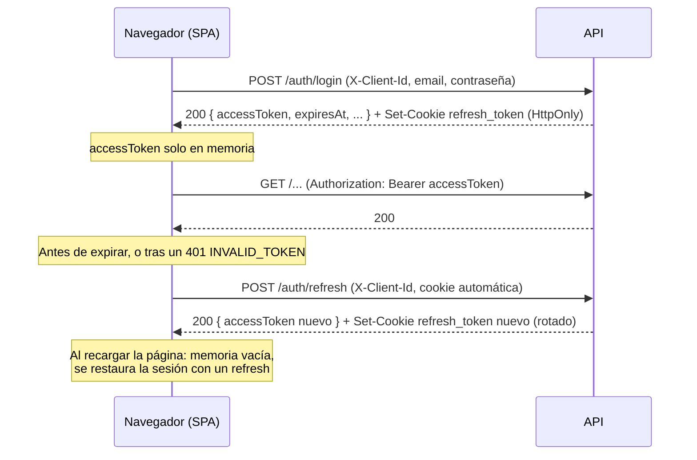

# Requerimientos del frontend

> **Estado:** borrador para revisión · **Fecha:** 2026-11-28 · **Backend de referencia:** rama `developer` (v1, fases 0 a 5 y despliegue)
>
> Este documento reúne lo que hace falta saber y decidir para construir un frontend que consuma este backend. Todo lo que se afirma sobre el comportamiento del servicio **se ha comprobado contra el backend en marcha** (secciones 3.1 y 4.4), salvo lo que se marca expresamente como supuesto o propuesta.
>
> Documentos relacionados: [ARCHITECTURE.md](ARCHITECTURE.md) (diseño del backend) · [DEPLOYMENT.md](DEPLOYMENT.md) (despliegue).

## Índice

1. [Qué es el backend y qué debe construir el frontend](#1-qué-es-el-backend-y-qué-debe-construir-el-frontend)
2. [Decisiones pendientes](#2-decisiones-pendientes)
3. [Contrato OpenAPI: verificación y huecos](#3-contrato-openapi-verificación-y-huecos)
4. [Entornos, conexión y CORS](#4-entornos-conexión-y-cors)
5. [Autenticación y sesión](#5-autenticación-y-sesión)
6. [Autorización en la interfaz](#6-autorización-en-la-interfaz)
7. [Catálogo de endpoints](#7-catálogo-de-endpoints)
8. [Manejo de errores](#8-manejo-de-errores)
9. [Requerimientos funcionales por pantalla](#9-requerimientos-funcionales-por-pantalla)
10. [Reglas de negocio que la interfaz debe respetar](#10-reglas-de-negocio-que-la-interfaz-debe-respetar)
11. [Requerimientos no funcionales](#11-requerimientos-no-funcionales)
12. [Limitaciones del backend que condicionan al frontend](#12-limitaciones-del-backend-que-condicionan-al-frontend)
13. [Plan de entrega propuesto](#13-plan-de-entrega-propuesto)
14. [Apéndice: datos de referencia](#14-apéndice-datos-de-referencia)

---

## 1. Qué es el backend y qué debe construir el frontend

El backend es un **servicio centralizado de identidad y control de acceso** (Java 25, Spring Boot 4, PostgreSQL). Gestiona usuarios y **N aplicaciones**; cada aplicación tiene sus propios clientes (web, móvil, servicio), roles y permisos. Un usuario puede tener acceso a varias aplicaciones, con roles distintos en cada una.

Puntos que condicionan todo el diseño del frontend:

- **No es un proveedor OAuth2/OIDC.** No hay `authorization_code`, PKCE ni redirecciones. El login es una llamada `POST` con email y contraseña, que devuelve un JWT. **No hay SSO**: cada aplicación tiene su propia pantalla de login, que habla directamente con este servicio.
- **El token es por aplicación.** Un access token lleva `aud` (código de la aplicación) y solo los roles y permisos de esa aplicación.
- **La propia plataforma es una aplicación** (`auth-admin`). Administrar usuarios, aplicaciones, roles y accesos exige un token emitido para `auth-admin` con los permisos correspondientes.

### Qué se puede construir

| Producto | Descripción | Usuarios |
|---|---|---|
| **A. Consola de administración** | Gestión de usuarios, aplicaciones, clientes, roles, permisos, accesos y auditoría | Administradores (token de `auth-admin`) |
| **B. Portal del usuario** | Perfil, cambio de contraseña, aplicaciones a las que puede entrar, sesiones abiertas | Cualquier usuario |
| **C. Pantalla de login para otras aplicaciones** | Cada aplicación protegida necesita su propio login contra este servicio | Usuarios finales de otras aplicaciones |

A y B son el alcance natural de este frontend. C se resuelve con la guía de integración de la sección 5 (cualquier aplicación puede implementar su login siguiendo ese flujo); si se quiere una pantalla de login compartida, hay que decidirlo (ver sección 2).

### Qué el backend **no** ofrece (no se puede construir hoy)

| No existe | Consecuencia para el frontend |
|---|---|
| Registro público de usuarios | No hay pantalla "Crear cuenta". Los usuarios los crea un administrador. El indicador `selfRegistration` de las aplicaciones existe en los datos, pero **ningún endpoint lo usa todavía** |
| Recuperación de contraseña por email | No hay "He olvidado mi contraseña". Un administrador restablece la contraseña (`PUT /admin/users/{id}/password`) |
| Verificación de email | `emailVerified` es siempre `false`. No mostrar avisos de "verifica tu correo" |
| MFA, login social, SSO | No planificar pantallas para ello |
| Edición del perfil (nombre, apellidos, email) | `MeResponse` es de solo lectura |
| Borrado de usuarios, aplicaciones, clientes, roles o permisos | Solo se pueden desactivar o bloquear |

Ver la lista completa de limitaciones en la [sección 12](#12-limitaciones-del-backend-que-condicionan-al-frontend).

---

## 2. Decisiones pendientes

Hay que resolverlas antes de empezar. Las recomendaciones son propuestas, no decisiones tomadas.

| # | Decisión | Opciones | Recomendación | Por qué importa |
|---|---|---|---|---|
| D1 | **Alcance** | Solo A · A + B · A + B + móvil | **A + B en web**, móvil después | Marca el número de pantallas y de clientes a registrar |
| D2 | **Stack web** | React, Angular, Vue… | **React + TypeScript (estricto) + Vite**, con TanStack Query y React Router | El equipo del backend es Java, pero eso no obliga a Angular. Lo importante es TypeScript estricto y cliente generado desde el OpenAPI |
| D3 | **Stack móvil** | Nativo, React Native, Flutter | Sin recomendación hasta fijar D1 | El móvil usa un flujo de refresh token distinto (sección 5.4) |
| D4 | **Topología de despliegue** | Mismo origen (proxy con `/api`) · Mismo sitio (`app.dominio.com` + `auth.dominio.com`) | **Mismo sitio como mínimo; mismo origen es lo más simple** | La cookie del refresh token es `SameSite=Strict`: si el frontend y la API están en **sitios distintos** (dominios registrables diferentes), el navegador **no enviará la cookie** y el login no se podrá renovar |
| D5 | **Aplicación del portal de usuarios** | Reutilizar `auth-admin` · **Crear una aplicación `portal`** | **Crear `portal`** con su propio cliente web | Para hacer login, un usuario necesita acceso efectivo a la aplicación del cliente. Si los usuarios corrientes entran por `auth-admin`, hay que darles acceso a la aplicación de administración (sin roles) |
| D6 | **¿Login compartido para otras aplicaciones (C)?** | Cada aplicación implementa el suyo · Pantalla de login alojada por este frontend | Cada aplicación el suyo, por ahora | Sin SSO, un login alojado no evita que cada aplicación gestione su sesión |
| D7 | **Idiomas** | Solo español · español + inglés | Español, con textos externalizados | Los mensajes del backend están en inglés (sección 8) |
| D8 | **Resolver los huecos del contrato OpenAPI** | Antes de empezar · Con tipos manuales | **Antes de empezar los prerrequisitos P0** (sección 3.3) | Sin ello, el cliente generado tiene tipos incorrectos |

---

## 3. Contrato OpenAPI: verificación y huecos

### 3.1 Verificación: el contrato existe y se sirve

Se arrancó el backend (`developer`, perfil `local`) y se analizó la especificación publicada.

| Comprobación | Resultado |
|---|---|
| `GET /v3/api-docs` | **200**, `application/json`, 28 KB, **sin autenticación** |
| `GET /swagger-ui.html` | **200** (redirige a la interfaz de Swagger) |
| `GET /v3/api-docs.yaml` | **401** (ver hueco 7) |
| Versión del formato | **OpenAPI 3.1.0** |
| Contenido | **27 rutas** (**35 operaciones**), **31 esquemas** (14 de petición y 17 de respuesta o auxiliares) |
| Seguridad | Esquema `bearer` (HTTP, JWT) |
| Etiquetas | Todas las operaciones tienen etiqueta (`Auth`, `Me`, `Admin · …`) |
| Identificadores de operación | Únicos (sin duplicados) |
| Parámetros | Rutas, consultas, cabecera `X-Client-Id` y cookie `refresh_token` documentados |
| Enumeraciones | Incluidas (`status`, `platform`, tipos de auditoría…) |
| Formatos | `uuid`, `date-time`, `email`, límites de longitud y de colección |

> **En producción el contrato está desactivado por defecto** (`OPENAPI_ENABLED=false`). El frontend debe generarse contra un backend local o de desarrollo, o contra una copia versionada del contrato.

**Conclusión: el OpenAPI existe y es utilizable como base**, pero tiene huecos que degradan el cliente generado.

### 3.2 Qué está bien

- Cubre todos los endpoints actuales (comparado con la sección 7).
- Los cuerpos de petición declaran los campos obligatorios (`required`) y los límites de longitud.
- Los parámetros de ruta, consulta, cabecera y cookie están descritos.
- Los esquemas se nombran de forma estable y clara (`UserResponse`, `PageResponseUserResponse`…).

### 3.3 Huecos detectados

| # | Hallazgo | Impacto en el frontend | Prioridad |
|---|---|---|---|
| 1 | **Todas las operaciones declaran la respuesta `200`**, pero varias devuelven **`201`** (crear usuario, aplicación, cliente, rol, permiso; conceder acceso nuevo) o **`204` sin cuerpo** (`logout`, `logout-all`, revocar acceso, cambiar o restablecer contraseña, cerrar una sesión) | Un cliente generado espera cuerpo JSON en un `204` y puede fallar al procesarlo. Los tipos de retorno de las creaciones son incorrectos | **P0** |
| 2 | **Ningún error está documentado**: no hay respuestas `4xx`/`5xx` ni esquema del cuerpo de error (Problem Details) | El cliente generado no tipa los errores. Hay que escribir el tipo a mano (sección 8) | **P0** |
| 3 | **Todos los campos de las respuestas son opcionales** (ninguno de los 17 esquemas de respuesta y auxiliares declara `required`) | En TypeScript, `accessToken?: string`, `id?: string`… Obliga a comprobar `undefined` en todas partes | **P0** |
| 4 | **Login, refresh y JWKS aparecen como protegidos** (heredan la seguridad `bearer` global) aunque son públicos | Un cliente generado puede exigir un token para hacer login | **P0** |
| 5 | **Los `operationId` son autogenerados** y poco claros: `list`, `list_1`, `list_2`, `list_3`, `list_4`, `get`, `get_1`, `get_2`, `create`, `create_1`, `create_2`, `update`, `update_1`, `revoke`, `revoke_1` | Los nombres de las funciones generadas serían ilegibles e **inestables**: añadir un controlador renumera los demás y rompe el código del frontend | P1 |
| 6 | **Los tipos de contenido de respuesta son `*/*`** en lugar de `application/json` | Algunos generadores no reconocen el cuerpo como JSON | P1 |
| 7 | **`/v3/api-docs.yaml` devuelve `401`** (la ruta no está en la lista pública) | Las herramientas que piden el YAML no pueden descargarlo sin token. El JSON sí funciona | P1 |
| 8 | **`info.version` es `dev`** y la URL del servidor es `http://localhost:8080` («Generated server url») | El contrato no indica qué versión de la API es ni dónde está | P1 |
| 9 | **La entrega del refresh token por cookie no se puede expresar en el esquema**: `TokenResponse.refreshToken` aparece siempre, pero **para clientes web nunca viene en el cuerpo** (va en `Set-Cookie`) | El cliente web debe ignorar ese campo. Se explica en la sección 5 | Informativo |
| 10 | **`Retry-After` no es legible desde el navegador** (CORS no lo expone); `Set-Cookie` tampoco lo es nunca | Para el tiempo de espera de un `429`, usar `retryAfterSeconds` del cuerpo (sección 8) | Informativo |

**Prerrequisitos de backend (P0).** Antes de generar el cliente, el backend debería corregir los huecos 1 a 4. Son cambios pequeños y localizados en la capa web del backend (anotaciones de OpenAPI), sin lógica de negocio. P1 puede hacerse en paralelo.

### 3.4 Cómo obtener y usar el contrato

```bash
# Arrancar el backend en local (requiere Docker, ver sección 4.4)
./mvnw spring-boot:run

# Descargar el contrato
curl -s http://localhost:8080/v3/api-docs -o openapi.json
```

**Propuesta de generación del cliente** (herramientas habituales; **no se han ejecutado en este repositorio**):

```bash
# Tipos TypeScript a partir del contrato
npx openapi-typescript http://localhost:8080/v3/api-docs -o src/api/schema.d.ts
```

Alternativas: `openapi-fetch` para las llamadas tipadas, u `orval` para generar además hooks de TanStack Query.

**Requisitos sobre el contrato:**

| ID | Requisito |
|---|---|
| OA-01 | El frontend **no escribe a mano** los tipos de petición y respuesta: se generan del contrato |
| OA-02 | El contrato se **versiona en el repositorio del frontend** (copia de `openapi.json`) y se actualiza de forma explícita |
| OA-03 | La integración continua **falla si los tipos generados difieren** de los que hay en el repositorio (detecta cambios no regenerados) |
| OA-04 | Mientras los huecos P0 existan, se aplica una **capa de tipos manual** encima (tipo de error, campos obligatorios, estados `201`/`204`) en **un único archivo**, para eliminarla cuando el backend los corrija |
| OA-05 | El cliente HTTP **no depende de los códigos de estado del contrato** para decidir el flujo; usa el estado real de la respuesta |

---

## 4. Entornos, conexión y CORS

### 4.1 URLs

| Entorno | API | Contrato |
|---|---|---|
| Local | `http://localhost:8080` | `/v3/api-docs`, `/swagger-ui.html` |
| Producción | Definida por el despliegue (por ejemplo `https://auth.example.com`) | **Desactivado** salvo `OPENAPI_ENABLED=true` |

### 4.2 Configuración del frontend

| Variable | Descripción |
|---|---|
| URL base de la API | Origen del backend. Si se sirve en el mismo origen, una ruta relativa (`/api/v1`) |
| `client_id` | Identificador público del cliente web registrado. Se envía en la cabecera `X-Client-Id` en **login y refresh** |

La configuración debe poder cambiarse **sin recompilar** (por ejemplo, un `config.json` cargado al arrancar) para usar la misma compilación en todos los entornos.

### 4.3 Clientes (`client_id`)

El `client_id` determina **a qué aplicación se hace login** y **cómo se entrega el refresh token**.

| Cliente | Aplicación | Plataforma | Uso |
|---|---|---|---|
| `auth-admin-web` | `auth-admin` | `WEB` | **Consola de administración.** Ya existe en la base de datos, **pero sin orígenes permitidos** (ver 4.4) |
| *(a crear)* | `portal` (decisión D5) | `WEB` | Portal de usuarios |
| *(a crear)* | `portal` | `MOBILE` | App móvil, si se construye |

### 4.4 CORS: el origen del frontend debe registrarse

El navegador solo puede llamar a la API desde orígenes registrados en el campo `allowedOrigins` de un cliente `WEB` activo. **El cliente `auth-admin-web` se crea con la lista vacía**, así que un frontend web **no puede hablar con la API hasta registrar su origen**.

Comprobado contra el backend en marcha:

| Situación | Resultado |
|---|---|
| Origen sin registrar | La preflight responde `200` **sin cabeceras `Access-Control-*`**: el navegador bloquea la petición |
| Origen registrado | `Access-Control-Allow-Origin` con ese origen y `Access-Control-Allow-Credentials: true` |
| Respuestas de error (`401`, `429`) | **También llevan cabeceras CORS**: el frontend puede leer su cuerpo |
| Cambio de la lista | **Tarda hasta 30 segundos en aplicarse** (la lista se cachea) |

**Cabeceras CORS actuales:**

| Cabecera | Valor |
|---|---|
| Métodos permitidos | `GET, POST, PUT, PATCH, DELETE, OPTIONS` |
| Cabeceras de petición permitidas | `Authorization`, `Content-Type`, `X-Client-Id` |
| Cabeceras de respuesta legibles | `Location`, `WWW-Authenticate` (**no** `Retry-After`) |
| Credenciales | Permitidas (necesario para la cookie del refresh token) |
| Caché de la preflight | 1 hora |

**Registrar el origen de desarrollo** (con el token de un administrador). La lista se **reemplaza completa**: incluye todos los orígenes:

```bash
curl -X PATCH http://localhost:8080/api/v1/admin/applications/00000000-0000-0000-0000-000000000001/clients/00000000-0000-0000-0000-000000000101 \
  -H "Authorization: Bearer $TOKEN" -H 'Content-Type: application/json' \
  -d '{"allowedOrigins": ["http://localhost:5173"]}'
```

Los orígenes son `esquema://host[:puerto]`, sin ruta, y como máximo 20.

| ID | Requisito |
|---|---|
| ENV-01 | Todas las peticiones a la API usan `credentials: 'include'` (o equivalente), porque el refresh token viaja en una cookie |
| ENV-02 | La documentación del frontend incluye el paso de registrar el origen de cada entorno y avisa del retraso de hasta 30 s |
| ENV-03 | En producción, el frontend y la API se sirven desde el **mismo sitio** (decisión D4) y por **HTTPS**: la cookie lleva el atributo `Secure` |

### 4.5 Levantar el backend para desarrollar

Requisitos: JDK 25 y Docker.

```bash
# Arranca la aplicación y PostgreSQL (Docker Compose automático en el perfil local)
AUTH_BOOTSTRAP_ADMIN_EMAIL=admin@local.test \
AUTH_BOOTSTRAP_ADMIN_PASSWORD='una contraseña de 12 o más caracteres' \
./mvnw spring-boot:run
```

- Crea el administrador inicial con rol `SUPER_ADMIN` en `auth-admin`.
- En local la cookie del refresh token **no** lleva `Secure` (se usa HTTP).
- Los datos persisten en un volumen de Docker entre arranques. Para empezar de cero: `docker compose down -v`.

---

## 5. Autenticación y sesión

Es la parte más delicada del frontend. Los requisitos nacen de cómo funciona el backend.

### 5.1 Flujo



- El **access token** es un JWT de vida corta (15 minutos por defecto, configurable por cliente).
- El **refresh token** es un valor opaco que **se usa una sola vez**: cada refresh devuelve uno nuevo.
- Si se presenta un refresh token **ya usado**, el backend asume que fue robado y **revoca la sesión entera** (`REFRESH_TOKEN_REUSED`).

### 5.2 Requisitos

| ID | Requisito | Motivo |
|---|---|---|
| AUTH-01 | **Login:** `POST /api/v1/auth/login` con cabecera `X-Client-Id` y cuerpo `{ email, password, deviceName? }`. Enviar `deviceName` (por ejemplo, navegador y sistema) para que el usuario reconozca sus sesiones | El nombre aparece en «Mis sesiones» |
| AUTH-02 | El **access token se guarda solo en memoria** (variable o estado de la aplicación). **Nunca** en `localStorage`, `sessionStorage`, cookies propias, IndexedDB ni en la URL | Un XSS no podría llevarse un token persistente |
| AUTH-03 | El frontend web **nunca ve el refresh token**: viaja en una cookie `HttpOnly`. No existe en el cuerpo de la respuesta de un cliente `WEB`. El código **no debe intentar leerlo ni enviarlo en el cuerpo** | El backend rechaza un refresh web con el token en el cuerpo (`INVALID_REFRESH_TOKEN`) |
| AUTH-04 | **Restaurar la sesión al cargar:** al arrancar la aplicación, llamar a `POST /auth/refresh`. Si responde `200`, hay sesión; si responde `401`, mostrar el login. Mientras tanto, mostrar un estado de carga (sin parpadeo del login) | La memoria se pierde al recargar |
| AUTH-05 | **Renovación proactiva:** renovar unos 60 s antes de `expiresAt`. **Renovación reactiva:** ante un `401` con código `INVALID_TOKEN`, renovar una vez y repetir la petición; si vuelve a fallar, ir al login | Evita errores visibles al usuario |
| AUTH-06 | **Un solo refresh a la vez**, dentro de la pestaña (las llamadas simultáneas esperan al mismo) **y entre pestañas** (por ejemplo, con la Web Locks API, `navigator.locks`). Como el navegador comparte la cookie, la segunda pestaña enviará la ya rotada por la primera | **Dos refresh simultáneos con el mismo token se interpretan como reutilización y cierran la sesión** |
| AUTH-07 | **Fallos del refresh:** `INVALID_REFRESH_TOKEN`, `REFRESH_TOKEN_REUSED`, `AUTH_ACCOUNT_INACTIVE`, `ACCESS_NOT_GRANTED` o `AUTH_INVALID_CLIENT` → borrar el estado y llevar al login con el mensaje correspondiente. `429` → esperar `retryAfterSeconds`. Error de red o `5xx` → reintentar con espera creciente **sin cerrar la sesión** | No cerrar sesión por un fallo transitorio |
| AUTH-08 | **Logout:** `POST /auth/logout` (requiere un access token válido; si ha caducado, renovar antes). Borrar el estado local **siempre**, aunque la llamada falle. `POST /auth/logout-all` cierra todos los dispositivos | El backend borra la cookie en la respuesta |
| AUTH-09 | **Sincronizar pestañas:** un logout o una sesión caducada en una pestaña debe reflejarse en las demás (por ejemplo, con `BroadcastChannel`) | Evita pestañas con una sesión muerta |
| AUTH-10 | Los claims del token (nombre, roles, permisos) se decodifican **solo para pintar la interfaz**. La seguridad real la impone el backend | Cualquiera puede alterar lo que ve en su navegador |
| AUTH-11 | La cabecera `Authorization` se envía **solo a la URL de la API**, nunca a terceros | Evita filtrar el token |
| AUTH-12 | Los errores de login muestran mensajes **genéricos** (sección 8). No indicar si el email existe | El backend responde igual en ambos casos a propósito |
| AUTH-13 | Los campos de contraseña usan `autocomplete` correcto (`current-password`, `new-password`), permiten el gestor de contraseñas y **nunca se registran en logs ni en herramientas de errores** | |
| AUTH-14 | Tras un cambio de contraseña (`PUT /users/me/password`), el backend cierra **las demás** sesiones y mantiene la actual. La interfaz lo comunica | |

### 5.3 Contenido del access token

Claims del JWT (RS256). Las demás aplicaciones lo validan con la clave pública de `/.well-known/jwks.json`.

| Claim | Contenido |
|---|---|
| `iss` | URL pública del servicio |
| `sub` | Identificador del usuario (UUID) |
| `aud` | Código de la aplicación (**texto**, no lista, cuando hay un solo destinatario) |
| `azp` | `client_id` que pidió el token |
| `sid` | Identificador de la sesión |
| `jti` | Identificador único del token |
| `iat`, `exp` | Emisión y caducidad (segundos desde 1970) |
| `email` | Email del usuario |
| `roles` | Códigos de los roles en esa aplicación |
| `permissions` | Permisos de esa aplicación (unión de los de sus roles) |

La respuesta del login también trae `expiresIn` (segundos) y `expiresAt` (fecha ISO): usarlos para planificar la renovación en lugar de decodificar el token.

### 5.4 Cliente móvil (si está en el alcance)

Difiere de la web en cómo se entrega el refresh token. La plataforma la decide **el cliente registrado**, no la petición: un cliente `MOBILE` nunca recibe cookie.

| Aspecto | `WEB` | `MOBILE` |
|---|---|---|
| Refresh token en el login | Cookie `HttpOnly` | **En el cuerpo** (`refreshToken`) |
| Enviar el refresh token | Automático (cookie) | Cuerpo `{ "refreshToken": "…" }` en `POST /auth/refresh` |
| Almacenamiento | Gestionado por el navegador | **Keychain (iOS) / Keystore (Android)**. Nunca en preferencias o ficheros sin cifrar |
| Validación de `Origin` | Sí (debe estar registrado) | No aplica |
| Duración por defecto del refresh token | 7 días | 30 días |

Se aplican las mismas reglas de rotación: un refresh token **se usa una sola vez**, así que hay que **guardar el nuevo antes de volver a usarlo** y serializar los refresh (AUTH-06). Si la app se cierra después de recibir el token nuevo y antes de guardarlo, el anterior ya está usado y la sesión se pierde.

### 5.5 Qué no hacer

- No guardar tokens en `localStorage` o `sessionStorage`.
- No lanzar dos refresh a la vez con el mismo token.
- No reintentar en bucle los `401` de login ni los `429`.
- No mostrar mensajes del servidor (`detail`) tal cual: están en inglés y pensados para desarrolladores.
- No ocultar un botón y dar la acción por protegida: el backend decide.

---

## 6. Autorización en la interfaz

### 6.1 Permisos de administración

La consola exige un token con `aud = auth-admin`. Un token de **otra aplicación** sirve para `/users/me/*`, pero **nunca** da acceso a la administración, aunque esa aplicación tenga un rol con el mismo nombre (responde `403 INSUFFICIENT_PERMISSIONS`).

| Pantalla / acción | Permiso necesario |
|---|---|
| Ver usuarios, ver un usuario | `users:read` |
| Crear usuario, cambiar estado, restablecer contraseña | `users:write` |
| Ver aplicaciones, clientes, roles y permisos | `applications:read` |
| Crear o editar aplicaciones, clientes, roles y permisos; rotar secretos | `applications:write` |
| Ver accesos (de una aplicación o de un usuario) | `access:read` |
| Conceder, modificar o revocar accesos | `access:write` |
| Ver la auditoría | `audit:read` |

**Roles de `auth-admin` creados de serie:**

| Rol | Permisos |
|---|---|
| `SUPER_ADMIN` | Todos los anteriores |
| `APP_MANAGER` | `applications:read`, `applications:write` |
| `ACCESS_MANAGER` | `applications:read`, `users:read`, `users:write`, `access:read`, `access:write` |
| `AUDITOR` | `audit:read` |

### 6.2 Requisitos

| ID | Requisito |
|---|---|
| AUTZ-01 | La navegación y las acciones se muestran según los **permisos del token** (`permissions`), no según los roles. Los roles pueden cambiar de significado; los permisos son lo que comprueba el backend |
| AUTZ-02 | Las rutas protegidas tienen **guardas** que redirigen a una pantalla «Sin permisos» (no al login) cuando el usuario está autenticado pero no tiene el permiso |
| AUTZ-03 | Ante un `403 INSUFFICIENT_PERMISSIONS`, mostrar «No tienes permiso para esta acción». **Una vez**, renovar el token y repetir: los permisos se recalculan en cada refresh, por si cambiaron |
| AUTZ-04 | Un usuario sin ningún permiso de administración que entra por `auth-admin-web` **debe ver «Sin permisos»**, no una consola vacía |
| AUTZ-05 | Un `AUDITOR` ve la auditoría pero **no puede resolver nombres** (no tiene `users:read`): mostrar los identificadores con opción de copiarlos |
| AUTZ-06 | Los permisos de las demás aplicaciones (`invoice:read`…) son **datos de esas aplicaciones**, no se usan para mostrar u ocultar nada de este frontend |

---

## 7. Catálogo de endpoints

Prefijo común: `/api/v1`. Los identificadores son UUID y las fechas, ISO-8601 en UTC (`2026-11-28T10:15:30Z`). Los cuerpos son `application/json`.

> **Fuente de verdad de los campos:** el contrato OpenAPI. Esta tabla da el **estado HTTP real** (el contrato dice `200` en todos; ver hueco 1) y las reglas que el contrato no expresa.

### 7.1 Autenticación y sesión

| Operación | Permiso | Petición | Respuesta real |
|---|---|---|---|
| `POST /auth/login` | Público | Cabecera `X-Client-Id`. Cuerpo `{ email, password, deviceName? }` | `200` `TokenResponse`. Web: cookie `refresh_token`. Móvil: `refreshToken` en el cuerpo |
| `POST /auth/refresh` | Público (cookie o cuerpo) | Cabecera `X-Client-Id`. Web: cookie. Móvil: `{ refreshToken }` | `200` `TokenResponse` (token rotado) |
| `POST /auth/logout` | Bearer | — | `204`. Borra la cookie |
| `POST /auth/logout-all` | Bearer | — | `204`. Borra la cookie |
| `GET /.well-known/jwks.json` (sin prefijo `/api/v1`) | Público | — | `200` claves públicas |
| `GET /actuator/health[/liveness\|/readiness]` (sin prefijo) | Público | — | `200` |

`TokenResponse`: `accessToken`, `tokenType` (`Bearer`), `expiresIn`, `expiresAt`, `refreshToken` (solo móvil), `refreshTokenExpiresAt`, `application`, `sessionId`.

### 7.2 Usuario autenticado (token de cualquier aplicación)

| Operación | Respuesta real | Notas |
|---|---|---|
| `GET /users/me` | `200` `MeResponse` (`id`, `email`, `firstName`, `lastName`, `status`, `emailVerified`, `createdAt`) | Solo lectura |
| `PUT /users/me/password` `{ currentPassword, newPassword }` | `204` | `400 INVALID_CURRENT_PASSWORD` o `PASSWORD_POLICY_VIOLATION`. Cierra las demás sesiones |
| `GET /users/me/applications` | `200` lista de `{ id, code, name, roles[] }` | Solo accesos **efectivos** a aplicaciones activas. No paginado |
| `GET /users/me/sessions` | `200` lista de `SessionResponse` | Incluye `current` (la sesión del token usado). No paginado |
| `DELETE /users/me/sessions/{sessionId}` | `204` | `404 SESSION_NOT_FOUND` si no existe, no es suya o ya estaba cerrada |

### 7.3 Administración de usuarios

| Operación | Permiso | Petición | Respuesta real |
|---|---|---|---|
| `GET /admin/users` | `users:read` | `email` (contiene, sin distinguir mayúsculas), `status`, `page`, `size` | `200` página de `UserResponse` |
| `POST /admin/users` | `users:write` | `{ email, password, firstName?, lastName? }` | **`201`** `UserResponse` + `Location` |
| `GET /admin/users/{userId}` | `users:read` | — | `200` `UserResponse` |
| `PATCH /admin/users/{userId}/status` | `users:write` | `{ status }` (`ACTIVE`, `LOCKED`, `DISABLED`) | `200` `UserResponse`. `LOCKED`/`DISABLED` cierra todas sus sesiones. `ACTIVE` también levanta un bloqueo temporal por intentos fallidos |
| `PUT /admin/users/{userId}/password` | `users:write` | `{ newPassword }` | `204`. Cierra todas las sesiones y levanta el bloqueo temporal |
| `GET /admin/users/{userId}/access` | `access:read` | — | `200` lista de `AccessResponse`. No paginado |

### 7.4 Administración de aplicaciones, clientes, permisos y roles

| Operación | Permiso | Petición | Respuesta real |
|---|---|---|---|
| `GET /admin/applications` | `applications:read` | `page`, `size` | `200` página de `ApplicationResponse` |
| `POST /admin/applications` | `applications:write` | `{ code, name, description? }` | **`201`** |
| `GET /admin/applications/{appId}` | `applications:read` | — | `200` |
| `PATCH /admin/applications/{appId}` | `applications:write` | `{ name?, description?, status?, selfRegistration?, defaultRoleId? }` | `200` |
| `GET /admin/applications/{appId}/clients` | `applications:read` | — | `200` lista de `ClientResponse`. No paginado |
| `POST /admin/applications/{appId}/clients` | `applications:write` | `{ clientId?, name, platform, allowedOrigins?, accessTokenTtlSeconds?, refreshTokenTtlSeconds? }` | **`201`** `ClientResponse`. Para `SERVICE`, incluye `clientSecret` **una sola vez** |
| `PATCH /admin/applications/{appId}/clients/{clientId}` | `applications:write` | `{ name?, allowedOrigins?, accessTokenTtlSeconds?, refreshTokenTtlSeconds?, status? }` | `200`. Aquí `{clientId}` es el **UUID interno** (campo `id`), no el `clientId` público |
| `POST /admin/applications/{appId}/clients/{clientId}/secret` | `applications:write` | — | `200` con el nuevo `clientSecret` (una sola vez). Solo clientes `SERVICE` (`422` en los demás). `{clientId}` es también el UUID interno |
| `GET /admin/applications/{appId}/permissions` | `applications:read` | — | `200` lista de `PermissionResponse`. No paginado |
| `POST /admin/applications/{appId}/permissions` | `applications:write` | `{ code, description? }` | **`201`** |
| `GET /admin/applications/{appId}/roles` | `applications:read` | — | `200` lista de `RoleResponse` (con sus permisos). No paginado |
| `POST /admin/applications/{appId}/roles` | `applications:write` | `{ code, name, description?, permissionIds? }` | **`201`** `RoleResponse` |
| `GET /admin/applications/{appId}/roles/{roleId}` | `applications:read` | — | `200` |
| `PUT /admin/applications/{appId}/roles/{roleId}/permissions` | `applications:write` | `{ permissionIds }` | `200`. **Reemplaza el conjunto completo** |

### 7.5 Accesos

| Operación | Permiso | Petición | Respuesta real |
|---|---|---|---|
| `PUT /admin/applications/{appId}/access/{userId}` | `access:write` | `{ roleIds, status?, validFrom?, validUntil? }` | **`201`** si el acceso es nuevo, **`200`** si ya existía. **Reemplaza la configuración completa** |
| `GET /admin/applications/{appId}/access/{userId}` | `access:read` | — | `200` `AccessResponse` |
| `DELETE /admin/applications/{appId}/access/{userId}` | `access:write` | — | `204`. El acceso queda en estado `REVOKED` (no se borra) |
| `GET /admin/applications/{appId}/access` | `access:read` | `status`, `page`, `size` | `200` página de `AccessResponse` |

### 7.6 Auditoría

| Operación | Permiso | Petición | Respuesta real |
|---|---|---|---|
| `GET /admin/audit-events` | `audit:read` | `type`, `userId` (como actor o destinatario), `applicationId`, `from` (inclusivo), `to` (exclusivo), `page`, `size` | `200` página de `AuditEventResponse`, del más reciente al más antiguo. `400` si `to` ≤ `from` |

### 7.7 Convenciones

- **Paginación:** `page` empieza en `0`; `size` vale `20` por defecto y **máximo `100`**. La respuesta es `{ content[], page, size, totalElements, totalPages }`.
- **PATCH:** solo se modifican los campos **enviados**. Un campo `null` o ausente significa «sin cambios»; **no se puede vaciar** un valor con `PATCH` (por ejemplo, borrar una descripción).
- **PUT:** reemplaza la configuración completa (roles de un acceso, permisos de un rol).
- **Campos nulos:** en general los campos sin valor (`firstName`, `description`, `validUntil`…) **se envían como `null`**. **Excepción:** `TokenResponse` y `ClientResponse` **omiten** los campos vacíos (por ejemplo, `refreshToken` en un cliente web o `clientSecret` en un cliente que no es `SERVICE`). Los tipos del cliente deben admitir ambos casos.
- **Operaciones que no existen:** borrar usuarios, aplicaciones, clientes, roles o permisos; editar un rol o un permiso; obtener **un solo** cliente o permiso (hay que filtrar la lista); editar el perfil propio.

---

## 8. Manejo de errores

### 8.1 Formato

Todos los errores son **Problem Details (RFC 9457)**, con `Content-Type: application/problem+json`:

```json
{
  "title": "Validation error",
  "status": 400,
  "detail": "Request validation failed",
  "instance": "/api/v1/admin/users",
  "code": "VALIDATION_ERROR",
  "timestamp": "2026-11-28T10:15:30.123Z",
  "errors": [{ "field": "email", "message": "must be a well-formed email address" }]
}
```

| Campo | Notas |
|---|---|
| `code` | **Identificador estable.** Es lo que debe usar el código para decidir |
| `status` | Estado HTTP |
| `title`, `detail` | **En inglés**, para desarrolladores. No mostrarlos al usuario |
| `instance` | Ruta de la petición |
| `timestamp` | Útil para soporte |
| `errors[]` | Solo en errores de validación (`VALIDATION_ERROR`, `PASSWORD_POLICY_VIOLATION`, `INVALID_CURRENT_PASSWORD`): `{ field, message }` por campo |
| `retryAfterSeconds` | Solo en `429` |
| `type` | Puede venir (`about:blank`) o no |

### 8.2 Códigos y acción de la interfaz

**Autenticación**

| `code` | HTTP | Cuándo | Acción de la interfaz |
|---|---|---|---|
| `AUTH_INVALID_CREDENTIALS` | 401 | Email inexistente, contraseña incorrecta **o cuenta bloqueada temporalmente** | «Correo o contraseña incorrectos, o la cuenta está bloqueada temporalmente». No distinguir |
| `AUTH_ACCOUNT_INACTIVE` | 401 | Contraseña correcta, pero la cuenta está bloqueada o deshabilitada por un administrador | «Tu cuenta no está activa. Contacta con un administrador» |
| `ACCESS_NOT_GRANTED` | 403 | Credenciales correctas, pero sin acceso vigente a la aplicación del cliente | «No tienes acceso a esta aplicación» |
| `AUTH_INVALID_CLIENT` | 401 | `X-Client-Id` desconocido, inactivo, o de una aplicación inactiva; o `Origin` no permitido en un refresh | Error de configuración del frontend o de despliegue: mensaje técnico y aviso a soporte |
| `AUTHENTICATION_REQUIRED` | 401 | Falta el token | Ir al login |
| `INVALID_TOKEN` | 401 | Token mal formado, manipulado, caducado o de otro emisor | Renovar una vez (AUTH-05); si falla, login |
| `INVALID_REFRESH_TOKEN` | 401 | Refresh token ausente, desconocido, caducado, revocado, o enviado por el canal equivocado | Login |
| `REFRESH_TOKEN_REUSED` | 401 | Se reutilizó un refresh token: **la sesión se ha revocado** | Login, con aviso de seguridad: «Por seguridad, tu sesión se ha cerrado» |
| `INSUFFICIENT_PERMISSIONS` | 403 | Token válido sin permiso para la operación | Ver AUTZ-03 |
| `TOO_MANY_REQUESTS` | 429 | Límite de intentos superado | «Demasiados intentos. Inténtalo de nuevo en N segundos», con `retryAfterSeconds` |

**Datos y reglas de negocio**

| `code` | HTTP | Acción de la interfaz |
|---|---|---|
| `VALIDATION_ERROR` | 400 | Marcar cada campo de `errors[].field` con su mensaje (traducido) |
| `MALFORMED_REQUEST` | 400 | Error de programación del frontend: mensaje genérico y registro |
| `PASSWORD_POLICY_VIOLATION` | 400 | Mostrar las reglas de la contraseña (sección 10) |
| `INVALID_CURRENT_PASSWORD` | 400 | «La contraseña actual no es correcta» en ese campo |
| `USER_NOT_FOUND`, `APPLICATION_NOT_FOUND`, `CLIENT_NOT_FOUND`, `PERMISSION_NOT_FOUND`, `ROLE_NOT_FOUND`, `ACCESS_NOT_FOUND`, `SESSION_NOT_FOUND`, `RESOURCE_NOT_FOUND` | 404 | «No se ha encontrado…»; refrescar la lista (pudo borrarlo otro administrador) |
| `USER_EMAIL_ALREADY_EXISTS` | 409 | «Ya existe un usuario con ese correo» en el campo |
| `APPLICATION_CODE_ALREADY_EXISTS`, `CLIENT_ID_ALREADY_EXISTS`, `PERMISSION_ALREADY_EXISTS`, `ROLE_ALREADY_EXISTS` | 409 | «Ese código ya existe» en el campo |
| `CONFLICT` | 409 | Modificación concurrente: «Otro usuario ha cambiado este dato. Recarga e inténtalo de nuevo» |
| `BUSINESS_RULE_VIOLATION` | 422 | Regla de negocio no cumplida. Mostrar un mensaje según la operación (ver sección 10) |
| `INVALID_CLIENT_CONFIGURATION` | 422 | Combinación no válida (orígenes en un cliente que no es web, secreto en un cliente público…) |
| `METHOD_NOT_ALLOWED`, `UNSUPPORTED_MEDIA_TYPE` | 405, 415 | Error de programación |
| `INTERNAL_ERROR` | 500 | «Ha ocurrido un error. Inténtalo más tarde». Mostrar `timestamp` para soporte |

### 8.3 Requisitos

| ID | Requisito |
|---|---|
| ERR-01 | Un **único** módulo traduce `code` → mensaje de usuario (con i18n) y acción. Los componentes no interpretan estados HTTP |
| ERR-02 | Un `code` desconocido (el backend puede añadir nuevos) cae en un mensaje genérico según el estado HTTP, **sin romper** |
| ERR-03 | Los errores de validación se asocian al campo concreto del formulario, no solo a un aviso global |
| ERR-04 | Los errores de red (sin respuesta) y los `5xx` se distinguen de los de negocio, con opción de reintentar |
| ERR-05 | **Nunca** se registran ni se envían a herramientas de seguimiento de errores: contraseñas, `Authorization`, cookies ni `clientSecret` |
| ERR-06 | Un `429` no genera reintentos automáticos hasta que pase `retryAfterSeconds`. **Se lee del cuerpo**: la cabecera `Retry-After` no es accesible desde el navegador |

---

## 9. Requerimientos funcionales por pantalla

Los criterios son comprobables. Las pantallas de A requieren los permisos de la sección 6.

### 9.1 Comunes

| ID | Pantalla | Requisitos |
|---|---|---|
| RF-01 | **Login** | Campos correo y contraseña. Mensajes de la sección 8. Botón desactivado durante la petición. Muestra el bloqueo por `429` con cuenta atrás. Sin «Crear cuenta» ni «Olvidé mi contraseña» (no existen en el backend; mostrar «Si has olvidado tu contraseña, contacta con un administrador» si se desea) |
| RF-02 | **Estructura general** | Menú según permisos, nombre del usuario, acceso a «Mi cuenta» y cierre de sesión |
| RF-03 | **Sesión caducada** | Mensaje claro y vuelta al login recordando la ruta de destino |
| RF-04 | **Sin permisos / no encontrada** | Pantallas diferenciadas (403 y 404) |
| RF-05 | **Estados de lista** | Cada lista tiene estado de carga, vacío y error con reintento |

### 9.2 Portal del usuario (B)

| ID | Pantalla | Requisitos |
|---|---|---|
| RF-10 | **Mi perfil** | Muestra correo, nombre, estado y fecha de alta. Solo lectura |
| RF-11 | **Cambiar contraseña** | Contraseña actual, nueva y confirmación. Validación local de la política (sección 10). Aviso: «Se cerrarán tus demás sesiones». Errores `INVALID_CURRENT_PASSWORD` y `PASSWORD_POLICY_VIOLATION` en su campo |
| RF-12 | **Mis aplicaciones** | Tarjetas con nombre, código y roles. Solo accesos efectivos. Vacío: «Aún no tienes acceso a ninguna aplicación» |
| RF-13 | **Mis sesiones** | Lista de dispositivos: aplicación, plataforma, dispositivo, IP, navegador, creación y último uso. La actual aparece marcada y sin botón de cerrar (para eso está «Cerrar sesión»). Botón por sesión y «Cerrar todas» con confirmación |

### 9.3 Consola de administración (A)

**Usuarios** (`users:*`)

| ID | Pantalla | Requisitos |
|---|---|---|
| RF-20 | **Lista de usuarios** | Paginada (20 por defecto). Filtro por correo (contiene) y por estado. Muestra correo, nombre, estado y alta |
| RF-21 | **Crear usuario** | Correo, contraseña inicial (con la política y un generador opcional), nombre y apellidos. Aviso de que la contraseña debe comunicarse por un canal seguro. `USER_EMAIL_ALREADY_EXISTS` en el campo |
| RF-22 | **Detalle de usuario** | Datos, estado y **sus accesos** (`GET /admin/users/{id}/access`). Acciones: cambiar estado, restablecer contraseña |
| RF-23 | **Cambiar estado** | Selector `ACTIVE`/`LOCKED`/`DISABLED` con **confirmación que explique la consecuencia**: bloquear o deshabilitar **cierra todas sus sesiones**; activar levanta un bloqueo temporal |
| RF-24 | **Restablecer contraseña** | Nueva contraseña con la política. Confirmación: «Se cerrarán todas sus sesiones» |

**Aplicaciones, clientes, roles y permisos** (`applications:*`)

| ID | Pantalla | Requisitos |
|---|---|---|
| RF-30 | **Lista de aplicaciones** | Paginada. Código, nombre y estado. `auth-admin` se distingue como **aplicación de la plataforma** |
| RF-31 | **Crear aplicación** | `code` con las reglas de la sección 10 (**no se podrá cambiar después**: avisarlo) y nombre |
| RF-32 | **Detalle de aplicación** | Editar nombre, descripción y estado. Activar el auto-registro exige un rol por defecto (de esa aplicación). Aviso de que desactivar la aplicación impide el login en todos sus clientes |
| RF-33 | **Clientes** | Lista por aplicación. Crear con plataforma `WEB`/`MOBILE`/`SERVICE`. Orígenes solo para `WEB`, con validación del formato. TTL con los rangos de la sección 10. Editar nombre, orígenes, TTL y estado |
| RF-34 | **Secreto de cliente** | Para `SERVICE`, el secreto se muestra **una sola vez** (al crear o rotar), en un diálogo que obliga a copiarlo y confirmar. **No se conserva en el estado ni en el historial** una vez cerrado. Rotar pide confirmación («el secreto anterior deja de valer ya») |
| RF-35 | **Permisos** | Catálogo por aplicación (lista y crear). Formato `recurso:accion` |
| RF-36 | **Roles** | Lista con sus permisos. Crear un rol con permisos iniciales. Asignar permisos con un selector múltiple que **reemplaza el conjunto completo** |

**Accesos** (`access:*`)

| ID | Pantalla | Requisitos |
|---|---|---|
| RF-40 | **Accesos de una aplicación** | Paginada, con filtro por estado. Muestra usuario, estado, roles, vigencia y la insignia **«Efectivo» / «No efectivo»** (campo `effective`) |
| RF-41 | **Conceder o editar acceso** | Estado, roles (solo los de esa aplicación), `validFrom` y `validUntil` (opcional, posterior al inicio). Distingue «concedido» (`201`) de «actualizado» (`200`). Aviso: suspender o revocar **cierra las sesiones del usuario en esa aplicación** |
| RF-42 | **Revocar acceso** | Confirmación. El acceso pasa a `REVOKED` y se puede volver a conceder |

**Auditoría** (`audit:read`)

| ID | Pantalla | Requisitos |
|---|---|---|
| RF-50 | **Registro de auditoría** | Paginado, del más reciente al más antiguo. Filtros: tipo, usuario, aplicación, rango de fechas. Muestra tipo, fecha, actor, destinatario, aplicación e IP |
| RF-51 | **Detalle de un evento** | Muestra `details` como **texto con formato** (nunca como HTML). Tipos de evento traducidos |

---

## 10. Reglas de negocio que la interfaz debe respetar

El **servidor es la fuente de verdad**: el frontend las replica solo para dar mensajes inmediatos. Un cambio en el backend manda sobre esta tabla.

| Tema | Regla |
|---|---|
| **Contraseña** | De **12 a 128** caracteres. Sin reglas de composición (no exige mayúsculas ni símbolos). **No** puede ser una contraseña común, ni un solo carácter repetido, ni **contener la parte local del correo** (lo que va antes de `@`). Al cambiarla, debe ser **distinta de la actual** |
| **Correo** | Máximo 254 caracteres. Se guarda en minúsculas y es **único sin distinguir mayúsculas** |
| **Nombre y apellidos** | Máximo 100 caracteres, opcionales |
| **Código de aplicación** (`code`) | 3 a 50 caracteres: letras minúsculas, dígitos y guiones; **empieza por letra y no termina en guion**. Se guarda en minúsculas. **No se puede cambiar** (es el `aud` del token) |
| **`client_id`** | 3 a 100 caracteres: minúsculas, dígitos y guiones. Si no se indica, se genera como `<aplicación>-<plataforma>` |
| **Código de rol** | 2 a 50 caracteres: **mayúsculas**, dígitos y `_`; empieza por letra. Único por aplicación |
| **Código de permiso** | `recurso:accion` (varios niveles posibles, por ejemplo `reports:sales:export`): minúsculas, dígitos y guiones. 3 a 100 caracteres. Único por aplicación |
| **Nombres y descripciones** | Nombre: hasta 100. Descripción: hasta 1000 |
| **Plataforma de un cliente** | `WEB`, `MOBILE` o `SERVICE`. **No se puede cambiar** tras crearlo. Solo `SERVICE` es confidencial y tiene secreto |
| **Orígenes** | Solo en clientes `WEB`. Formato `http(s)://host[:puerto]`, sin ruta ni parámetros. Máximo 20. Se normalizan a minúsculas y sin duplicados |
| **TTL del access token** | De **60 s a 3600 s** (1 min a 1 h). Por defecto 900 s |
| **TTL del refresh token** | De **3600 s a 7 776 000 s** (1 h a 90 días). Por defecto 7 días (web) y 30 días (móvil) |
| **Auto-registro** | Activarlo exige un **rol por defecto** que pertenezca a la misma aplicación (`422` si no). *Hoy ningún endpoint lo utiliza.* |
| **Permisos de un rol** | Todos deben ser **de la misma aplicación** que el rol |
| **Roles de un acceso** | Todos deben ser **de la misma aplicación** que el acceso |
| **Acceso** | Uno por usuario y aplicación. Estado por defecto `ACTIVE`. `validUntil` debe ser **posterior** a `validFrom`. Es **efectivo** solo si está `ACTIVE`, dentro de su vigencia **y** la aplicación está activa |
| **Revocar un acceso** | No se borra: queda `REVOKED` y puede volver a concederse |
| **Bloqueo temporal** | Tras **5 intentos fallidos seguidos** la cuenta se bloquea 15 minutos; cada fallo adicional **duplica** el tiempo, hasta 24 h. Un login correcto lo reinicia. Un administrador lo levanta activando la cuenta o restableciendo la contraseña |
| **Límite de intentos** | Login: 30 por minuto y por IP, 10 por minuto y por correo. Refresh: 120 por minuto y por IP. **Varios usuarios tras la misma IP (una oficina) comparten el límite por IP** |
| **Sesiones** | Cierre de todas las sesiones al: bloquear o deshabilitar al usuario, restablecer su contraseña, suspender o revocar un acceso (solo las de esa aplicación). Cambiar la contraseña propia cierra las demás |
| **Access token tras cerrar sesión** | Sigue siendo válido hasta que caduca (15 min por defecto). El frontend lo descarta, pero **otras aplicaciones lo aceptarán** hasta entonces |

---

## 11. Requerimientos no funcionales

### 11.1 Seguridad

| ID | Requisito |
|---|---|
| SEC-01 | Servir **solo por HTTPS**, con HSTS y redirección desde HTTP |
| SEC-02 | **Content-Security-Policy** estricta: sin `unsafe-inline` ni `unsafe-eval`, `frame-ancestors 'none'`, `connect-src` limitado a la API. Sin scripts de terceros en las pantallas de login y de contraseña |
| SEC-03 | **Nunca** renderizar datos del servidor como HTML (`dangerouslySetInnerHTML`, `innerHTML`). En especial los de la auditoría (`details`, correos, nombres) |
| SEC-04 | Dependencias con **auditoría automática de vulnerabilidades** en CI y archivo de bloqueo versionado |
| SEC-05 | Sin secretos en el código ni en la configuración pública del frontend: todo lo que llega al navegador es público |
| SEC-06 | `Referrer-Policy: no-referrer` o equivalente, y sin tokens ni identificadores sensibles en la URL |
| SEC-07 | Comprobación de integridad de los recursos de terceros si los hay (SRI), preferiblemente ninguno |
| SEC-08 | El `clientSecret` de un cliente `SERVICE` no se guarda en ningún almacén (estado global, caché de consultas, historial, registros) |
| SEC-09 | Revisión de seguridad específica del módulo de autenticación antes de abrir al público |

### 11.2 Accesibilidad

| ID | Requisito |
|---|---|
| ACC-01 | Cumplir **WCAG 2.1 nivel AA** |
| ACC-02 | Todo es operable con teclado, con foco visible y orden lógico |
| ACC-03 | Los errores de formulario se anuncian a lectores de pantalla (`aria-live`) y se asocian a su campo |
| ACC-04 | Contraste suficiente; la información no depende solo del color (los estados llevan texto) |
| ACC-05 | Tablas con cabeceras semánticas y paginación accesible |

### 11.3 Internacionalización

| ID | Requisito |
|---|---|
| I18N-01 | Idioma principal **español**; **todos los textos externalizados** para poder añadir otros |
| I18N-02 | El servidor devuelve fechas en **UTC**: mostrarlas en la zona horaria del usuario, con formato local (`Intl`). Al enviar `validFrom`/`validUntil`, convertir a UTC |
| I18N-03 | Los **códigos de error** y los **tipos de evento de auditoría** se traducen con diccionarios propios: el backend los devuelve en inglés o como constantes |

### 11.4 Rendimiento y compatibilidad

| ID | Requisito |
|---|---|
| PERF-01 | Carga por rutas (code splitting): la pantalla de login no descarga la consola de administración |
| PERF-02 | Las listas usan **paginación del servidor**; nunca se cargan todos los datos para filtrar en el navegador |
| PERF-03 | Caché de consultas con invalidación tras las modificaciones (por ejemplo, tras crear un usuario se recarga la lista) |
| PERF-04 | *(Propuesta)* Primera carga del login rápida en una conexión móvil estándar. Fijar un presupuesto concreto de tamaño al iniciar el proyecto |
| COMP-01 | Navegadores actuales de escritorio y móvil (últimas dos versiones principales). Si se usa la Web Locks API (AUTH-06), prever una alternativa para los que no la tengan |
| COMP-02 | **Diseño adaptable.** La consola, usable desde tableta; el portal, pensado primero para móvil |

### 11.5 Calidad y entrega

| ID | Requisito |
|---|---|
| QA-01 | TypeScript en modo estricto, linter y formateo automáticos |
| QA-02 | **Pruebas unitarias del cliente de autenticación**: un solo refresh a la vez, reintento tras `401`, restauración de sesión, fallos de refresh, sincronización entre pestañas. Es el código con más riesgo |
| QA-03 | **Pruebas de componentes** de los formularios (validaciones y mensajes de error por `code`) |
| QA-04 | **Pruebas de extremo a extremo** con un navegador real contra el backend real (puede levantarse con `compose.prod.yaml`; ver `scripts/smoke-test.sh` como modelo): login, refresh, logout, un flujo de cada pantalla de administración, y el caso de reutilización del refresh token |
| QA-05 | Integración continua: tipos, linter, pruebas, compilación, **comprobación de que los tipos generados están al día (OA-03)** y auditoría de dependencias |
| QA-06 | Cobertura mínima *(propuesta)* del 80 % en la capa de autenticación y de acceso a la API |
| DEL-01 | Entrega como **recursos estáticos** (CDN o servidor web) con *fallback* a `index.html` para las rutas de la SPA; opcionalmente una imagen de contenedor |
| DEL-02 | Caché larga para los recursos con huella y **sin caché** para `index.html` y `config.json` |
| DEL-03 | Cabeceras de seguridad (SEC-01, SEC-02) configuradas en el servidor del frontend |
| OBS-01 | Seguimiento de errores del frontend **sin datos personales ni tokens** (ERR-05) |

---

## 12. Limitaciones del backend que condicionan al frontend

Resumen de lo que el backend **no hace o hace de forma distinta a lo esperable**, y qué implica para la interfaz. Algunas son mejoras previstas para versiones futuras.

| # | Limitación | Implicación |
|---|---|---|
| L1 | **No hay registro público** de usuarios (el indicador `selfRegistration` existe, pero ningún endpoint lo usa) | Sin pantalla de alta. Los usuarios los crea un administrador |
| L2 | **No hay recuperación de contraseña ni verificación de correo** | Sin «Olvidé mi contraseña». Un administrador restablece la contraseña |
| L3 | **No hay SSO** | Cada aplicación tiene su login; entrar en una no inicia sesión en otra |
| L4 | **No hay edición del perfil propio** | «Mi perfil» es de solo lectura |
| L5 | **No hay borrado** de usuarios, aplicaciones, clientes, roles ni permisos | Solo desactivar o bloquear. Los datos erróneos no se pueden eliminar |
| L6 | **No hay `GET` de un cliente o permiso individual**; el `PATCH` de un cliente usa su UUID interno | Obtenerlos filtrando la lista |
| L7 | **Varias listas no están paginadas**: clientes, permisos, roles, sesiones y accesos de un usuario | Aceptable con pocos datos; atención si crecen |
| L8 | **Filtros limitados**: usuarios solo por correo y estado; aplicaciones sin búsqueda; auditoría sin búsqueda por nombre | Filtrar en el cliente solo sobre lo ya cargado |
| L9 | **Cambios de orígenes CORS: hasta 30 s** de retraso | Avisarlo en la documentación y en la interfaz de clientes |
| L10 | **`Retry-After` no es legible** desde el navegador | Usar `retryAfterSeconds` del cuerpo |
| L11 | **Dos refresh simultáneos con el mismo token cierran la sesión** | AUTH-06 es obligatorio |
| L12 | **Los access tokens no se pueden revocar**: tras cerrar sesión siguen válidos hasta caducar | Aceptable para 15 min; documentarlo |
| L13 | **Una sola clave de firma**. Cambiarla invalida los access tokens vigentes (los clientes se recuperan renovando) | Una oleada de `401 INVALID_TOKEN` se resuelve con AUTH-05 |
| L14 | **Límites de intentos por instancia** y por IP | Varios usuarios tras la misma IP comparten el límite |
| L15 | **Contrato OpenAPI con los huecos de la sección 3.3**, y desactivado en producción | Resolver P0 antes de generar el cliente |
| L16 | **Los mensajes (`title`, `detail`) están en inglés** | Traducir por `code` |
| L17 | **No hay notificaciones en tiempo real** | Sin actualización automática: botón de recarga y refresco al volver a la pestaña |
| L18 | El **refresh token web exige `Origin` registrado** y la cookie es `SameSite=Strict` | Mismo sitio obligatorio (D4) |

---

## 13. Plan de entrega propuesto

| Fase | Contenido | Criterio de aceptación |
|---|---|---|
| **F0. Decisiones y contrato** | Resolver D1 a D8. **Backend: corregir los huecos P0 del OpenAPI** (3.3). Registrar los clientes y orígenes de desarrollo | Contrato regenerado con estados, errores, campos obligatorios y rutas públicas correctos |
| **F1. Base** | Proyecto, TypeScript estricto, cliente generado (OA-01 a OA-03), configuración en tiempo de ejecución, integración continua, sistema de diseño base e i18n | CI en verde, con la comprobación de tipos generados |
| **F2. Autenticación** | Login, restauración de sesión, refresh proactivo y reactivo, un solo refresh a la vez, logout, sincronización entre pestañas, guardas de rutas, manejo de errores (sección 8) | Pruebas unitarias y e2e de QA-02 y QA-04 en verde, incluida la reutilización de un refresh token |
| **F3. Portal del usuario** | RF-10 a RF-13 | Un usuario inicia sesión, cambia su contraseña y cierra una sesión ajena |
| **F4. Administración I** | Usuarios (RF-20 a RF-24), aplicaciones y clientes (RF-30 a RF-34) | Un administrador crea una aplicación y un cliente web y el origen se usa desde el propio frontend |
| **F5. Administración II** | Permisos y roles (RF-35, RF-36), accesos (RF-40 a RF-42), auditoría (RF-50, RF-51) | Un administrador da acceso a un usuario, que ve la aplicación en el portal |
| **F6. Endurecimiento y entrega** | Accesibilidad (ACC), CSP y cabeceras (SEC), revisión de seguridad, rendimiento, documentación y despliegue | Lista de comprobación de la definición de terminado |

**Definición de terminado de cada fase:**

- Los requisitos de la fase se cumplen y están probados.
- No hay tipos manuales que dupliquen el contrato (salvo la capa temporal de OA-04).
- Accesibilidad y seguridad revisadas en lo que se añade.
- Textos externalizados y traducidos.
- Documentación actualizada (incluidas las decisiones nuevas).

---

## 14. Apéndice: datos de referencia

### 14.1 Datos de serie (`auth-admin`)

| Elemento | Valor |
|---|---|
| Aplicación `auth-admin` | `00000000-0000-0000-0000-000000000001` |
| Cliente `auth-admin-web` (UUID interno) | `00000000-0000-0000-0000-000000000101` (plataforma `WEB`, access 900 s, refresh 604 800 s, **sin orígenes**) |
| Permisos | `applications:read`, `applications:write`, `users:read`, `users:write`, `access:read`, `access:write`, `audit:read` |
| Roles | `SUPER_ADMIN` (`…0301`), `APP_MANAGER` (`…0302`), `ACCESS_MANAGER` (`…0303`), `AUDITOR` (`…0304`) |

### 14.2 Tipos de evento de auditoría

`LOGIN_SUCCEEDED`, `LOGIN_FAILED`, `ACCOUNT_TEMPORARILY_LOCKED`, `ACCOUNT_UNLOCKED`, `LOGOUT`, `LOGOUT_ALL`, `SESSION_REVOKED`, `REFRESH_TOKEN_REUSED`, `USER_CREATED`, `USER_STATUS_CHANGED`, `PASSWORD_CHANGED`, `PASSWORD_RESET`, `ACCESS_GRANTED`, `ACCESS_REVOKED`, `APPLICATION_CREATED`, `APPLICATION_UPDATED`, `CLIENT_CREATED`, `CLIENT_UPDATED`, `CLIENT_SECRET_ROTATED`, `PERMISSION_CREATED`, `ROLE_CREATED`, `ROLE_PERMISSIONS_CHANGED`.

`LOGIN_FAILED` incluye en `details.reason`: `UNKNOWN_USER`, `INVALID_PASSWORD`, `TEMPORARILY_LOCKED`, `ACCOUNT_INACTIVE`, `ACCESS_NOT_GRANTED` o `INVALID_CLIENT`.

### 14.3 Lista de comprobación del primer día

- [ ] Backend local en marcha con el administrador inicial (sección 4.5).
- [ ] Iniciar sesión con `auth-admin-web` desde `curl` y comprobar los claims del token.
- [ ] Registrar el origen del frontend en `auth-admin-web` y esperar 30 s (sección 4.4).
- [ ] Descargar `openapi.json` y versionarlo (OA-02).
- [ ] Comprobar en el navegador que la cookie del refresh token llega (`HttpOnly`, `SameSite=Strict`, `Path=/api/v1/auth`).
- [ ] Decidir D1 a D8 y registrar las respuestas en este documento.
- [ ] Crear la aplicación `portal` y su cliente web, si D5 lo confirma.
